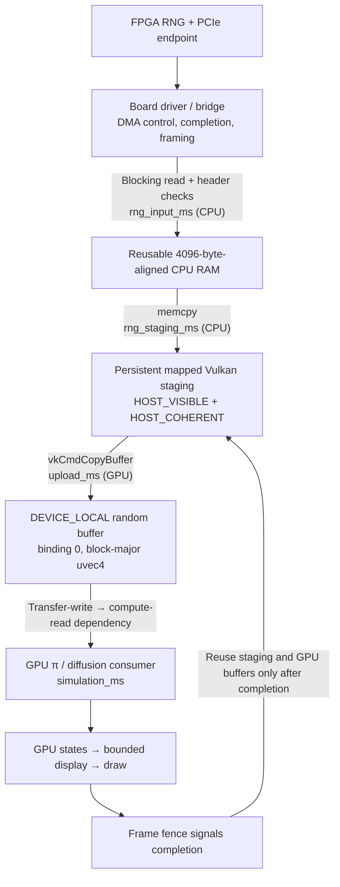

# Jetson Orin Nano + PCIe FPGA integration

The application provides a GPU baseline and a **staged external RNG input path**
for this system. The Jetson GPU runs the π estimator or diffusion simulation and
its bounded visualizer. An FPGA producer can supply random blocks through a
driver/bridge implementing the `RNG1` stream below. The application reads those
blocks, uploads them, and runs the same split consumer shader.

The software path does not configure an FPGA DMA engine, program its bitstream,
or implement a vendor driver. It does not import DMA-BUF memory, issue peer DMA
into Vulkan allocations, or overlap multiple frames. The current measurement
package is from an Apple M5 development machine. **No Jetson or FPGA/PCIe
performance results have been collected in this workspace session.**

## Build on the Jetson

Use the Jetson's installed JetPack/NVIDIA Vulkan driver. NVIDIA documents Vulkan
1.3 for Jetson Linux R36.4.3; check the installed release rather than assuming the
board has that exact software version. The application checks actual queue,
memory, buffer-size, and timestamp capabilities at startup.
[NVIDIA graphics API support](https://docs.nvidia.com/jetson/archives/r36.4.3/DeveloperGuide/SD/Graphics/GraphicsAPIs.html)

On an Ubuntu-based Jetson installation, install the build dependencies using the
repositories appropriate for that JetPack release:

```sh
sudo apt update
sudo apt install cmake g++ libvulkan-dev libglfw3-dev glslang-tools \
  vulkan-validationlayers python3
```

The build accepts GLFW 3.3+ and either `glslc` or `glslangValidator`. It uses the
installed Vulkan ICD; no macOS MoltenVK variables are needed. From the repository
root:

```sh
cmake -S graphics/rng_vulkan -B graphics/rng_vulkan/build -DCMAKE_BUILD_TYPE=Release
cmake --build graphics/rng_vulkan/build --parallel
ctest --test-dir graphics/rng_vulkan/build --output-on-failure

# A finite run that needs no display server:
graphics/rng_vulkan/run.sh --headless --workload pi --mode fused \
  --count 65536 --blocks 16 --warmup 20 --frames 120 --csv /tmp/jetson-pi.csv

# Full GPU baseline matrix, including independent RNG/consumer envelopes:
python3 graphics/rng_vulkan/tools/profile.py \
  --counts 4096,65536 --blocks 16,64 --output /tmp/jetson-gpu-baseline
```

`--headless` still runs offscreen Vulkan graphics unless `--no-viz` is present.
Omit `--headless` for the interactive window. Validate correctness separately
with `--validation`; collect performance with validation disabled. Record
JetPack/kernel/driver versions, power mode, clocks, cooling, and negotiated PCIe
link settings with the results so later trials have a comparable environment.
For external runs, also record the FPGA bitstream/source revision, RNG design
and clock, driver/bridge version, transfer buffering, and producer stream
configuration. A file fixture or CPU producer must be identified as such.

## Data path and ownership

The intended PCIe topology has the Jetson as root port and the FPGA as endpoint.
Jetson endpoint-mode flashing instructions describe a different role and are
not required for this arrangement. Carrier routing, controller selection, lane
width, and negotiated speed determine the usable link. NVIDIA lists Gen3 support
for Orin Nano; verify the actual board connection and link status.
[NVIDIA PCIe controller guidance](https://docs.nvidia.com/jetson/archives/r36.4.3/DeveloperGuide/HR/JetsonModuleAdaptationAndBringUp/JetsonOrinNxNanoSeries.html#pcie-controller-features)



Each batch is fully read and metadata-checked before GPU upload. The aligned
ordinary RAM buffer allows a driver to pin suitable userspace pages when its
contract supports that. The extra CPU copy into Vulkan staging is deliberate:
the program does not assume the driver can pin or DMA into Vulkan-mapped pages.
The staging memory is coherent for host/Vulkan access, but that property does
not establish FPGA DMA completion. The driver/bridge must return completed,
CPU-visible bytes before the application consumes them.

The frame fence prevents staging or GPU-buffer reuse while earlier GPU work can
still read them. The application submits one complete frame at a time. A later
ring-buffer implementation could overlap production, transfer, and consumption,
but would require separate ownership and completion tracking for every slot.
On Orin, CPU and integrated GPU share system DRAM. The Vulkan staging-to-device
upload is another DRAM copy/access path, not a second traversal of the external
PCIe link.

## RNG1 stream protocol

`--rng-stream PATH` opens a regular file, FIFO, or readable device as a byte
stream. It requires normal `--mode split` and cannot use `--isolate`. Each epoch
contains one **32-byte little-endian header**, followed immediately by exactly
`count * blocks * 16` payload bytes. Eight unsigned 32-bit header fields are:

| Byte offset | Field | Required value |
| ---: | --- | --- |
| 0 | magic | `0x31474e52`, bytes `RNG1` |
| 4 | version | `1` |
| 8 | count | Current invocation/walker count |
| 12 | blocks | Philox-sized four-word blocks per invocation |
| 16 | epoch | Current simulation epoch, beginning at zero |
| 20 | seed | CLI seed, an agreed producer stream identifier |
| 24 | workload | `0` for π, `1` for diffusion |
| 28 | flags | `0` |

Payload layout is block-major. For block `b` and invocation `i`, its four uint32
words occupy payload byte offsets `16 * (b * count + i)` through the next 15
bytes, all little-endian. In the default Philox baseline they are generated by
counter `(i,b,epoch,workload)` and key `(seed,0)`. The transport protocol permits
another producer RNG; its distribution, stream independence, and quality must
be suitable for the simulation.

The reader rejects mismatched metadata and incomplete batches rather than
silently reusing random data. It handles partial stream reads. The stream must
include **all warmup epochs**: a run with `--warmup 20 --frames 120` consumes 140
framed batches, epochs 0–139. The source is consumed sequentially and is not
rewound for each frame. A blocking producer/driver controls when bytes arrive;
hardware timeout/cancellation and device control are outside this byte-stream
protocol.

If the FPGA exposes raw DMA payloads, a board-specific bridge can add headers
and send the framed stream through a FIFO. If its driver can provide framing
directly, the application's path can be that readable device. Verify alignment,
DMA descriptor sizes, completion behavior, cache visibility, and short-read
semantics against the actual driver. Do not assume a particular XDMA device
name, ioctl set, or library API without inspecting the selected board design.

## Verify the software transport before connecting hardware

The fixture generator is a small CPU implementation of Philox for correctness
checks, not a high-throughput RNG or DMA benchmark. Its default verification
shape is 259 invocations × 7 blocks × 3 epochs, seed 42.

```sh
python3 graphics/rng_vulkan/tools/make_rng_stream.py --self-test

python3 graphics/rng_vulkan/tools/make_rng_stream.py --workload pi \
  --count 259 --blocks 7 --frames 3 --seed 42 --output /tmp/pi-rng1.bin
graphics/rng_vulkan/run.sh --headless --mode split --workload pi \
  --rng-stream /tmp/pi-rng1.bin --verify --validation

python3 graphics/rng_vulkan/tools/make_rng_stream.py --workload walk \
  --count 259 --blocks 7 --frames 3 --seed 42 --output /tmp/walk-rng1.bin
graphics/rng_vulkan/run.sh --headless --mode split --workload walk \
  --rng-stream /tmp/walk-rng1.bin --verify --validation
```

`--verify` uses that fixed small shape and checks uploaded words plus simulation
states against the CPU Philox reference across three epochs. A hardware RNG
with different output words is not expected to pass the Philox oracle, even if
its transport and statistical quality are correct. First use an FPGA/bridge
Philox-compatible test pattern or compare captured payloads with the expected
producer output; validate a different RNG separately.

For a normal external run, configure a fresh producer for the exact workload,
count, blocks, seed, and warmup+measured epoch schedule, then run, for example:

```sh
# /tmp/fpga-rng1.fifo is supplied by your board-specific framed producer.
mkdir -p /tmp/jetson-external
graphics/rng_vulkan/run.sh --headless --mode split --workload pi \
  --count 65536 --blocks 16 --seed 42 --warmup 20 --frames 120 \
  --rng-stream /tmp/fpga-rng1.fifo --csv /tmp/jetson-external/pi.csv

python3 graphics/rng_vulkan/tools/profile.py --summarize-only \
  --output /tmp/jetson-external
```

Create the output directory before the run. Do not point the automatic matrix
runner at a single finite external fixture: matrix cases have different
workloads, dimensions, and epochs, and each process needs its own producer
configuration. The runner automates GPU-generated baselines only; summarization
accepts manually collected external CSVs.

## Measure the complete handoff

| Metric | Scope |
| --- | --- |
| `rng_source` | `gpu` or `external`; kept separate in summaries |
| `rng_input_ms` | CPU blocking read/driver wait and header validation into aligned RAM |
| `rng_staging_ms` | CPU memcpy into persistent mapped Vulkan staging |
| `upload_ms` | GPU copy from staging to the device random buffer |
| `simulation_ms` | GPU consumer phase, including its random-buffer reads |
| `compute_ms` | GPU upload + consumer + dependencies in the external path |
| `gpu_ms` | Whole measured GPU envelope, also including visualization if enabled |
| `cpu_ms` | Complete frame wall time including external input, staging, GPU wait, and presentation |

The external path reports `rng_ms=0`: it does not time FPGA generation with GPU
timestamps. If generation/PCIe transfer blocks the driver read, that wait is
visible in `rng_input_ms`. If the producer has already buffered data, input read
time alone does not measure its generation throughput. Capture producer/driver
throughput and queue occupancy as well as application frame time.

Compare the external path's median/p95 **frame `cpu_ms` and useful samples/steps
per second** against the Jetson fused GPU baseline with the same workload and
display configuration. Also compare visualization off/on and increasing batch
sizes. A lower external GPU time can simply mean that RNG work and waiting moved
outside the GPU timestamps; it is not itself an application speedup.

## Bandwidth budget before optimizing the bridge

At `count=65536`, `blocks=64`, each epoch carries:

```text
65536 × 64 × 16 = 67,108,864 payload bytes = 64 MiB
header = 32 additional bytes
```

Even an ideal Gen3 ×4 link has a line-coding ceiling of approximately
`8 GT/s × 4 lanes × (128/130) / 8 = 3.938 GB/s`. Dividing 64 MiB by that ceiling
gives a **17.0 ms transfer floor** before packet/DMA overhead, CPU copies,
synchronization, or GPU consumption. At 60 batches/s, the payload alone requires
4.03 GB/s, already beyond that ideal ceiling. Narrower/slower negotiated links
increase the floor. This is a theoretical budget, not measured Jetson bandwidth.
With 16 blocks instead of 64, the same 65,536 invocations require 16 MiB per
epoch and an ideal floor of about 4.26 ms.
[AMD PCIe bandwidth reference](https://docs.amd.com/api/khub/documents/VEqb08t7hXQpd206i2oPnw/content)

Measure the actual link and driver path, then compare its delivery+copy+consumer
time with the **Jetson** fused kernel. The Apple M5 timings cannot establish that
comparison. If raw random-word delivery costs more than GPU generation, a
different partition—such as keeping a larger stochastic kernel on the FPGA and
returning compact results—may be a better experiment than offloading RNG alone.
The existing GPU state buffer at binding 1 is a natural future handoff boundary:
65,536 four-word states occupy 1 MiB, and π partial-hit counts could be even
smaller. Importing FPGA-computed state or partial results is not implemented by
the current RNG1 input path.

## Future shared-buffer path

DMA-BUF import is a separate integration project. It requires an actual
DMA-BUF-exporting driver, supported Vulkan external-memory extensions and buffer
handle capability queries, compatible memory types/allocations, and explicit
ownership/completion synchronization. An ordinary character-device descriptor
is not automatically an importable memory object.
[Vulkan DMA-BUF extension](https://docs.vulkan.org/refpages/latest/refpages/source/VK_EXT_external_memory_dma_buf.html)

Check `VK_EXT_external_memory_dma_buf` and `VK_KHR_external_memory_fd`, query the
buffer handle's `IMPORTABLE` support, honor memory-type and dedicated-allocation
requirements, and implement the applicable external ownership/fence contract.
CUDA GPUDirect RDMA availability on a Tegra platform does not establish Vulkan
buffer-import support; that requires its own capability and driver validation.
[Vulkan external-resource capabilities](https://docs.vulkan.org/spec/latest/chapters/capabilities.html),
[NVIDIA GPUDirect on Tegra](https://docs.nvidia.com/cuda/gpudirect-rdma/#porting-to-tegra)

Cache coherency and producer completion are separate concerns. Follow the
exporter/importer DMA-BUF CPU-access and fence contracts; coherent memory alone
does not mean the FPGA has finished writing or that the GPU has finished reading.
The current staged implementation makes those copies and waits explicit and
does not claim zero-copy operation.
[Linux DMA-BUF synchronization](https://docs.kernel.org/driver-api/dma-buf.html)
