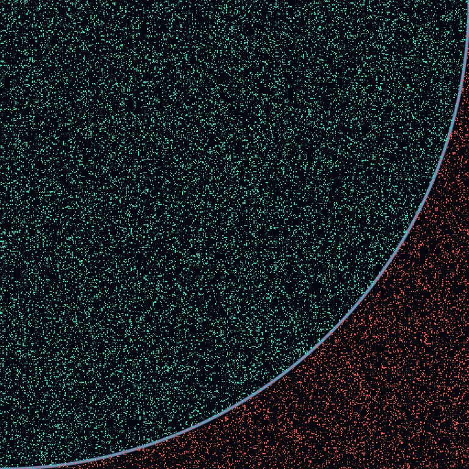
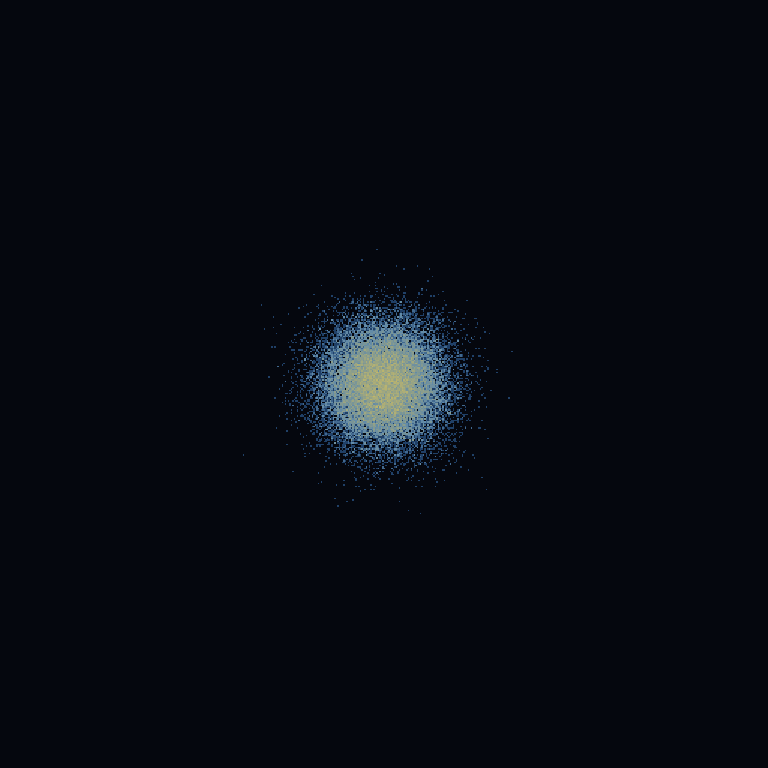

# Measured GPU baseline — Apple M5, 28 October 2026

Both visualizers and the external RNG transport are implemented. This measurement
package supplies a development GPU baseline for the planned **Jetson Orin Nano +
PCIe FPGA** experiment. It contains **no Jetson or physical FPGA/PCIe timing**.
See the [Jetson and FPGA integration guide](../../JETSON_FPGA.md) for the target
build, input contract, synchronization, and bandwidth budget.

## Results

For 65,536 independent invocations and 64 Philox blocks each, one batch consumes
16,777,216 uint32 random values and performs 8,388,608 π samples or diffusion
steps. Medians below pool 360 measured frames per configuration (three process
trials). All times are milliseconds.

| Workload | Isolated RNG + stores | Isolated consumer + reads | Fused compute | Visual preparation + draw | Fused GPU total with display |
| --- | ---: | ---: | ---: | ---: | ---: |
| Monte Carlo π | 0.8645 | 0.6071 | 0.9198 | 0.0240 | 0.9468 |
| Random-walk diffusion | 0.8404 | 0.6261 | 1.0940 | 0.0232 | 1.1201 |

The independent RNG/consumer envelope ratio is 58.7% for π and
57.3% for diffusion. These are ratios of independent measured
submissions, each including instrumentation; they are not pure RNG instruction
fractions or application speedup predictions. RNG-only includes materialized
stream stores, and consumer-only includes stream reads. Consumer inputs are
fresh for the current epoch, prepared in a separate untimed GPU submission.

Fusion improves compute throughput by 1.60× for π and
1.39× for diffusion compared with the separated visualized pipeline.
Visual preparation plus drawing occupies about 2.5% and
2.1% of the respective fused GPU envelopes. The fused
compute medians with visualization off are 0.9129 ms and
1.0890 ms. Thus rendering stays inexpensive at this size and RNG
is a substantial investigation target. **These measurements do not establish
that the optimized fused workload is RNG-bound or that FPGA offload is faster.**

The final π batch estimates **3.14138365** from 8,388,608 samples; its approximate
95% sampling half-width is 0.00111140. Diffusion begins at the center and wraps
periodically; after 140 epochs its wrapped mean squared radius is 0.6212.
The unwrapped expectation (1.1947) is larger because wrapping has become material.

## Method and evidence

- Apple M5, arm64, macOS 27.0.1, MoltenVK 1.4.2 (driver value 10402).
- Release C++17 build; glslc optimization enabled; full Philox4x32-10.
- Counts 4,096 and 65,536; blocks 16 and 64; both workloads; split/fused;
  display on/off; independent RNG-only and consumer-only measurements.
- 144 shuffled runs; 120 measured frames after 20 warmup frames per run;
  three trials per configuration; 17,280 measured frame records. Seed 42.
- Performance runs disable validation. Correctness and visual smoke checks run
  separately with Vulkan synchronization validation enabled.
- Timestamp ticks use a 1 ns period and 64 valid bits. Apple builds insert small
  blit sentinels because MoltenVK defers tile-GPU timestamp samples to encoder
  ends. Probe/sentinel work adds overhead. Phase windows remain approximate;
  use independent whole-submission envelopes for the stronger cross-check.
- The full compute envelope is used for fused timings. In this final matrix,
  large 65,536 × 64 fused runs have minimum compute times of
  0.9104 ms (π) and
  1.0874 ms (diffusion), avoiding the implausibly short
  phase windows found before the encoder-boundary fix. Raw outliers are retained.

[Full report](report.md), [machine-readable summary](summary.json),
[source/build provenance and hashes](provenance.json), and
[raw measurements and verification archive](raw.zip) are retained. The archive
contains `raw/` (144 CSVs, logs, and manifest) and `checks/` (CPU/Vulkan check logs,
external file-input smoke CSVs, and deterministic fixture inputs). Check CSVs
use validation and tiny workloads; they are correctness evidence, not PCIe
performance measurements. The original process commands in logs retain their
local paths; summary source references use portable `raw/` paths.

To reproduce the summary after extracting the archive in a new directory:

```sh
unzip raw.zip
python3 /path/to/GraphicsDFX/graphics/rng_vulkan/tools/profile.py \
  --summarize-only --output raw
```

To collect a fresh baseline from the repository root:

```sh
python3 graphics/rng_vulkan/tools/profile.py \
  --counts 4096,65536 --blocks 16,64 --output /tmp/rng-new-profile
```

Repeat that command on the Jetson, then compare the external source's complete
frame latency against its fused GPU baseline. A raw 64 MiB RNG batch has a
roughly 17 ms theoretical Gen3 ×4 transfer floor before staging and consumption;
[the target integration guide](../../JETSON_FPGA.md#bandwidth-budget-before-optimizing-the-bridge)
derives this budget and describes the FPGA RNG-plus-consumer alternative.

## Visual snapshots

These native Vulkan images show a bounded subset of samples/endpoints after six
epochs at 65,536 invocations × 16 blocks. Snapshot readback/encoding occurs after
timing. Monte Carlo uses teal for hits and red for misses; diffusion uses a
logarithmic endpoint-density color scale.

| Monte Carlo π | Random-walk diffusion |
| --- | --- |
|  |  |
